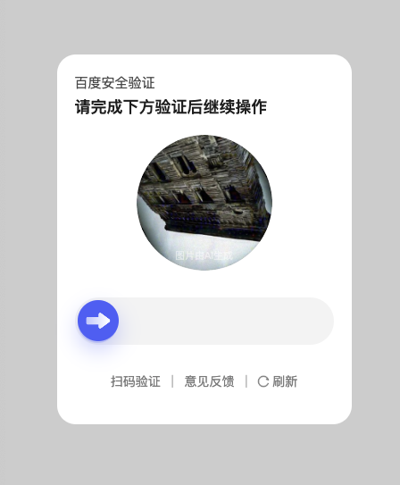
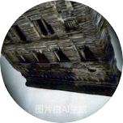
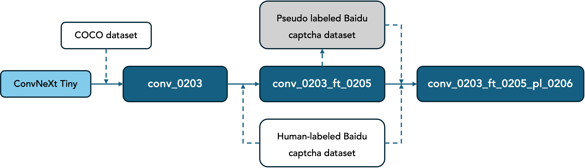

# Rotate-Captcha-Solver: Image Rotation Angle Recognition

**[中文](README.md) | English**

## 1. Project Overview ([Demo](https://youtu.be/Zg-WKu0SYj0))

This project aims to solve the problem of recognizing the rotation angle of a single image captcha. The core idea is to use a deep learning model to predict the rotation angle of the captcha, enabling automated processing. Using Baidu captchas as examples, this project employs ConvNeXt Tiny as the backbone model and formulates a regression task to predict angles. Model performance is enhanced via fine-tuning and pseudo-label-based semi-supervised learning.

<div align="center">
  
</div>

Baidu captcha image: 152px * 152px, white background, the inscribed circle contains the image that needs to be rotated.

<div align="center">
  
</div>

## 2. Method Overview

<div align="center">
  
</div>

### 2.1 Data Processing

- Uses the [COCO dataset](https://www.kaggle.com/datasets/awsaf49/coco-2017-dataset/data) as the base. Each of 20,000 original images is randomly rotated at 5 different angles to construct the training dataset.
- The model is trained with a regression task to directly predict the angle.

### 2.2 Model Architecture

- ConvNeXt Tiny is used as the backbone, loaded with pre-trained weights.
- The classification head is modified to predict rotation angles.
- To handle the periodicity of angles (e.g., 0° = 360°), the model outputs `sin` and `cos` values instead of raw angles.

### 2.3 Loss Function

CyclicMSELoss is used, combining Mean Squared Error (MSE) and Cosine Similarity Loss, making it more suitable for cyclic angle regression.

### 2.4 Fine-Tuning

The model is fine-tuned on 200 manually labeled Baidu captcha images to better adapt to the specific features of the captcha images.

### 2.5 Semi-Supervised Learning

- The fine-tuned model is used to infer angles on unlabeled captcha images.
- High-confidence predictions are selected as pseudo-labels.
- A mix of real and pseudo-labeled data is used to retrain the model, enhancing generalization.

## 3. Model Performance

| **Model Name**              | **MAE (COCO Test Set)** | **MAE (Baidu Captcha Test Set)** | **Real Pass Rate** |
|:---------------------------:|:------------------------:|:---------------------------------:|:------------------:|
| conv_0203                   | **13.49°**              | 27.52°                            | 61.67%             |
| conv_0203_ft_0205           | 15.55°                  | 5.83°                             | 71.53%             |
| **conv_0203_ft_0205_pl_0206** | 15.80°                | **5.56°**                         | **73.33%**         |

- COCO test set: 10,000 randomly rotated images (each image is rotated once at a random angle), sourced from the COCO validation set.
- Baidu captcha test set: 200 rotated captcha images derived from 20 original ones, each rotated at 10 random angles.
- Real pass rate: Based on statistics from 1,500 real-world test runs.

## 4. Environment

Refer to `requirements.txt`.

## 5. Installation & Usage

### 5.1 Clone and Install Dependencies

```bash
# Clone the project
git clone https://github.com/your-repo/rotate-captcha-solver.git
cd rotate-captcha-solver

# Install dependencies
pip install -r requirements.txt
```

### 5.2 Download Pretrained Model

- Link: [Google Drive](https://drive.google.com/drive/folders/1PLGtuWGZ3Ppsco3jg2vrgWkG0OeRFZWv?usp=sharing)
- Place the downloaded model in the `models` directory in the root folder.

### 5.3 Inference

Refer to `inference.py`.

### 5.4 Training

- Training:
  1. Split raw training images into `train`, `val`, and `test` folders.
  2. Adjust paths and parameters in `generate_imgs.py` to randomly rotate images for augmentation.
  3. Adjust paths and parameters in `train.py` and run it.
- Fine-tuning:
  1. Manually label images by renaming them. Naming rule: If rotating `example.png` (clockwise) by 39.99°, rename it as `example_rot39_99_0.png` (the trailing `0` is an ID to differentiate augmented versions).
  2. Adjust paths and parameters in `restore_imgs.py` to revert image angles.
  3. Run `generate_imgs.py` to augment the restored images.
  4. Run `finetune.py`.
- Pseudo-labeling:
  1. Use `restore_pseudo.py` to infer and generate pseudo-labeled images.
  2. Augment pseudo-labeled data with `generate_imgs.py`.
  3. Retrain using `finetune.py`.

### 5.5 Evaluation

Refer to `evaluate.py`.

### 5.6 Real-World Testing

Refer to `real_test.py`.

## 6. Code Structure

```bash
rotate-captcha-solver
├── caps                     # Baidu captcha images
│    ├── raw_labeled_caps    # Manually labeled captchas
│    └── unlabeled_caps      # Unlabeled captcha images
├── imgs                     # COCO dataset
│    ├── test                # COCO testing set
│    ├── train               # COCO training set
│    └── val                 # COCO validation set
├── models                   # Trained models
├── readme_imgs              # Images for README
├── utils                    # Utility functions
│    ├── crawler_utils.py    # Web crawler utilities
│    ├── image_utils.py      # Image processing utilities
│    └── model_utils.py      # Model-related tools (e.g., mask, architecture mods)
├── download_caps.py         # Captcha downloader
├── evaluate.py              # Evaluation script
├── finetune.py              # Fine-tuning
├── generate_imgs.py         # Image generation & augmentation
├── inference.py             # Inference
├── real_test.py             # Real-world testing
├── restore_imgs.py          # Restore labeled image angles
├── restore_pseudo.py        # Pseudo-label generation and restoration
└── train.py                 # Training
```